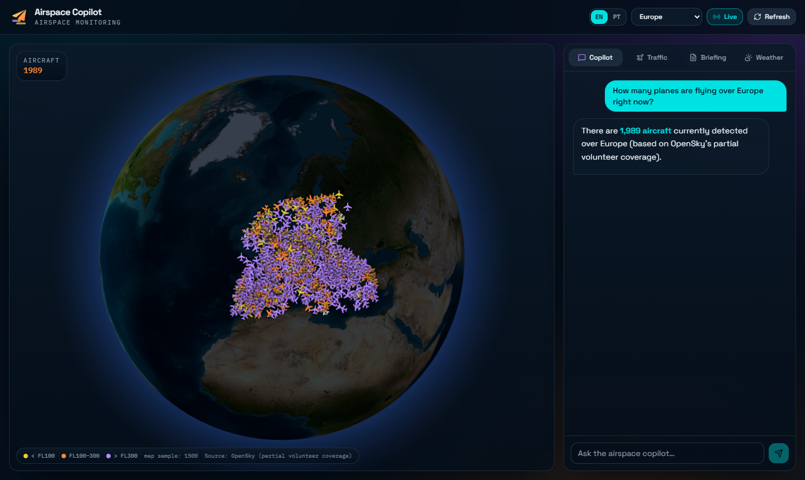
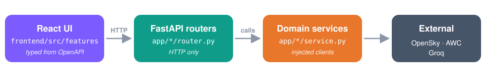
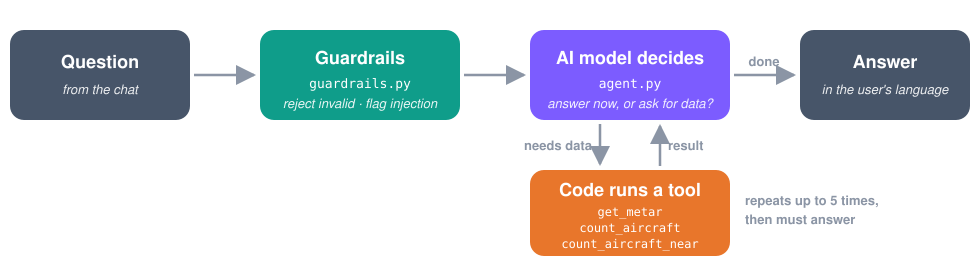

# ✈️ airspace-copilot

An AI copilot that explains live air traffic and aviation weather in plain English or Portuguese.

## What it does

🌍 **Live traffic**: aircraft on a 3D globe, per continent or the whole world

📝 **Briefing**: a short AI summary of the current airspace

🌦️ **Weather decoding**: `SBGR 091800Z 19011G21KT 6000…` explained in plain words

💬 **Copilot chat**: *"Is the weather good for landing in Guarulhos?"*, streamed as it's written

📊 **Evaluation**: the weather decoder scored against hand-checked answers

## Quick start

**What you need**

🐍 **Python 3.12+**, ⚡ **[uv](https://docs.astral.sh/uv/)** and 🟩 **Node.js 22+**

🔑 **Groq API key** (runs the AI): [console.groq.com](https://console.groq.com)

🛰️ **OpenSky client ID and secret** (flight data): [opensky-network.org](https://opensky-network.org) → Account → API Client

**Steps**

**① Add your keys**: copy `backend/.env.example` to `backend/.env` and fill in `GROQ_API_KEY`, `OPENSKY_CLIENT_ID` and `OPENSKY_CLIENT_SECRET`

**② Terminal 1, start the API**: `cd backend`, then `uv sync`, then `uv run uvicorn app.main:app --reload --port 8000`

🧰 **Prefer pip?** Create and activate a venv (`python -m venv .venv`, then `.venv\Scripts\Activate.ps1`; macOS/Linux: `source .venv/bin/activate`), then `cd backend`, `pip install -e . --group dev` (pip 25.1+) and `uvicorn app.main:app --reload --port 8000`

**③ Terminal 2, start the UI**: `cd frontend`, then `npm install`, then `npm run dev`

**④ Open** http://localhost:8080 🎉

The UI calls the API at `http://localhost:8000` by default. To use another address, copy `frontend/.env.example` to `frontend/.env.local` and change `VITE_API_BASE_URL`.

## Optional settings

Add any of these to `backend/.env` (all listed in `backend/.env.example`):

🤖 `LLM_MODEL`: Groq model, default `openai/gpt-oss-120b`

🌐 `CORS_ORIGINS`: sites allowed to call the API, comma-separated, default `http://localhost:8080`

💬 `ASK_RATE_LIMIT_PER_MINUTE`: chat questions per user per minute, default `10`

🌦️ `WEATHER_RATE_LIMIT_PER_MINUTE`: weather lookups per user per minute, default `20`

🪵 `LOG_LEVEL` / `LOG_FORMAT`: default `INFO` / `text`; use `json` in production

🏢 `USE_SYSTEM_TRUSTSTORE`: set to `1` on corporate networks with certificate errors

## Troubleshooting

😶 **Page loads but shows no data**: check that terminal 1 (the API) is still running

🔀 **UI calling the wrong API**: check `VITE_API_BASE_URL` in `frontend/.env.local`, then restart `npm run dev`

🔒 **Certificate / SSL errors**: add `USE_SYSTEM_TRUSTSTORE=1` to `backend/.env` and restart the API

⏳ **`429 llm_rate_limited`**: the Groq quota ran out, so wait a minute

🔎 **Tracing a request**: every response has an `X-Request-ID` header, and the same ID appears in the API logs

🤝 **Contributing**: see [CONTRIBUTING.md](CONTRIBUTING.md) · 📜 **Changes**: see [CHANGELOG.md](CHANGELOG.md)

## Project map

🧠 **`backend/`**: FastAPI app organised by domain. See [backend/README.md](backend/README.md)

🖥️ **`frontend/`**: React SPA organised by feature. See [frontend/README.md](frontend/README.md)

📐 **`docs/adr/`**: why things are the way they are. See [the decision log](docs/adr/README.md)

## How the copilot answers

🔒 **Only 2 read-only tools**: the AI can't do anything beyond reading data

🧾 **Tool schemas come from Pydantic models**: arguments are validated before anything runs

🔁 **Max 5 rounds**: no endless loops

♻️ **Repeated call forces an answer**: the AI never fetches the same data twice

🛡️ **Guardrails flag manipulation**: suspicious questions are logged and answered safely ([why that's enough](docs/adr/0007-guardrails.md))

⚡ **Answers stream token by token** over Server-Sent Events ([ADR 0005](docs/adr/0005-streaming-answers.md))

## Saving AI tokens

📉 **Briefings send counts, not every aircraft**: about 200 tokens, even for the whole world

♻️ **Briefings are reused** until traffic changes by about 10%

🌦️ **Each weather report is decoded once**

⏱️ **Flight data is cached for 30 s**, so all users share one OpenSky call

Every AI call logs its cost, e.g. `tokens briefing: prompt=412 completion=180 total=592`.

## Evaluation

The weather decoder is compared field by field with answers checked by hand against the ICAO/FAA spec. Latest run (5 cases × 3):

✅ **97.3%** of fields correct

🎯 **66.7%** perfect runs

⚠️ **Open issues**: sometimes explains codes missing from the docs (`VCTS`), and sometimes refuses documented ones (`FEW025`)

Run it from `backend/` with `uv run python -m evals.evaluate --repeat 3`. It spends Groq tokens.

🧭 **Agent tool selection**: `uv run python -m evals.agent_eval --repeat 3` checks that the copilot picks the right tool and arguments for questions in English and Portuguese ([cases](backend/evals/agent_cases.json))

## Quality checks

🧪 **Backend**: 95+ tests with fakes for every external service, 95% coverage, `mypy --strict`, ruff

🧪 **Frontend**: Vitest + Testing Library + MSW, Playwright end-to-end, strict TypeScript

♿ **Accessibility**: every tab is audited with axe (WCAG 2.1 A/AA) in the end-to-end tests

🔐 **Dependencies**: check with `uv run --with pip-audit pip-audit --skip-editable` and `npm audit`

📜 **Contract**: the frontend's API types are generated from the backend's OpenAPI, so a breaking change is a type error

▶️ `make check` runs lint, types and tests for both sides (or see the commands in each README)

## Known limitations

🌊 **Few aircraft over oceans**: OpenSky relies on volunteer ground receivers

🤖 **The AI can still make mistakes**: RAG reduces errors but doesn't remove them

🧮 **Single process**: caches and rate limits live in memory, so scaling out needs a shared store ([ADR 0002](docs/adr/0002-async-and-injected-clients.md))
