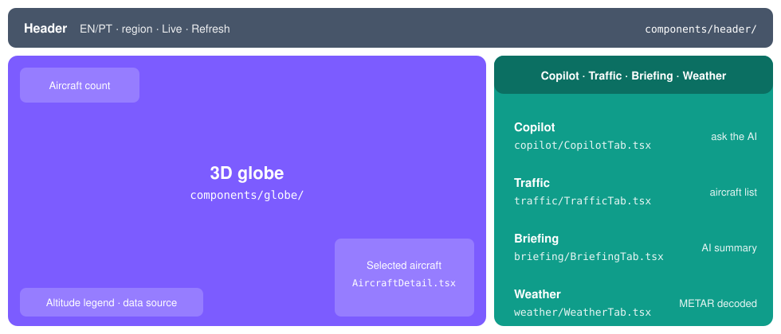

# 🖥️ Frontend

React 19 + TypeScript SPA. It only shows what the API returns; there is no logic and no secrets here.



## Run it

Start the API first ([root README](../README.md#quick-start)), then, inside `frontend/`:

**① Point to your local API**: create `.env.local` containing `VITE_API_BASE_URL=http://localhost:8000`

**② Install packages** (first time only): `npm install`

**③ Start**: `npm run dev`, then open http://localhost:8080

**Other commands**

`npm test`: unit and component tests (Vitest + Testing Library + MSW)

`npm run test:e2e`: browser tests with Playwright (API mocked) plus an axe accessibility audit of every tab. On a locked-down network use your installed Edge: `PW_CHANNEL=msedge npm run test:e2e`

`npm run build`: static build in `dist/`

`npm run lint` / `npm run typecheck`: code style and strict TypeScript

`npm run api:types`: regenerate API types from `openapi.json`

## Where to find things

Components follow the screen: one folder per area, and everything drawn inside that area lives in it.

```
src/
├── routes/index.tsx          🧭 the page: puts Header, GlobePanel and Sidebar together; URL state
├── components/
│   ├── header/               🔝 top bar
│   │   ├── Header.tsx
│   │   ├── Brand.tsx         logo + title
│   │   └── LanguageToggle, RegionSelect, LiveToggle, RefreshButton
│   ├── globe/                🌍 left panel
│   │   ├── GlobePanel.tsx    the panel and its overlays
│   │   ├── GlobeView.tsx     the 3D globe itself
│   │   ├── hooks/            useGlobeControls, useFlyToRegion, useSunLight, useMarkerSync…
│   │   ├── TrafficCounter, TrafficAlert, AltitudeLegend
│   │   ├── AircraftDetail.tsx + AircraftStats.tsx   card for the selected aircraft
│   │   └── markerElement.ts, markers.ts, sun.ts
│   ├── sidebar/              📑 right panel
│   │   ├── Sidebar.tsx       tab bar + panels
│   │   ├── tabs.ts           tab ids and icons
│   │   ├── copilot/          CopilotTab, CopilotWelcome, ChatMessage, ChatInput, useCopilotChat
│   │   ├── traffic/          TrafficTab, TrafficList, TrafficRow
│   │   ├── briefing/         BriefingTab, BriefingStats
│   │   └── weather/          WeatherTab, IcaoForm, MetarReport
│   ├── pages/                📄 NotFoundPage, ErrorPage
│   └── ui/                   🧱 shared pieces: Button, Tabs, Markdown, Logo, ErrorBoundary
│       └── state/            LoadingState, EmptyState, ErrorState, SkeletonLines, PanelBoundary
├── api/                      🔌 data: typed client + one file per endpoint group (traffic, briefing, weather, copilot)
├── lib/                      🧰 units, SSE parser, cn
│   └── i18n/                 🌐 provider, useErrorMessage, locales/en.ts + locales/pt.ts
└── config.ts                 ⚙️ regions, default airports, API address
```

🌐 **Texts and translations**: `src/lib/i18n/locales/en.ts` and `pt.ts`; TypeScript fails if a key is missing in one of them. API errors are translated by their `error` code

⛔ **Don't edit** `src/routeTree.gen.ts` or `src/api/schema.gen.ts`. They are generated.

## API types

The backend's Pydantic models are the source of truth. When the API changes:

**①** `cd backend && uv run python -m scripts.export_openapi ../frontend/openapi.json`

**②** `cd frontend && npm run api:types`

If you skip this, TypeScript points at every place the frontend no longer matches the API.

## Globe markers

🟨 **Yellow**: low, below ~3,000 m

🟧 **Orange**: medium, 3,000–9,000 m

🟪 **Violet**: cruising, above ~9,000 m

⬜ **Grey**: on the ground

Above 1,500 aircraft the globe draws a spread-out sample, while the counter always shows the real total.

## Data refresh

✈️ **Aircraft**: every 60 s while **Live** is on, because positions change constantly

📝 **Briefing**: every 5 min, because it uses AI and traffic changes slowly

🌦️ **Weather**: every 15 min, because it uses AI and new reports are rare

💬 **Copilot**: streamed as it is written, and cancelled if you leave the page

🚫 **4xx errors**: never retried, because retrying won't fix them

⚠️ **OpenSky down**: the last positions stay on the map with a **Stale** badge

🧯 **A panel crashes**: only that panel shows an error with a reload button; the rest keeps working
